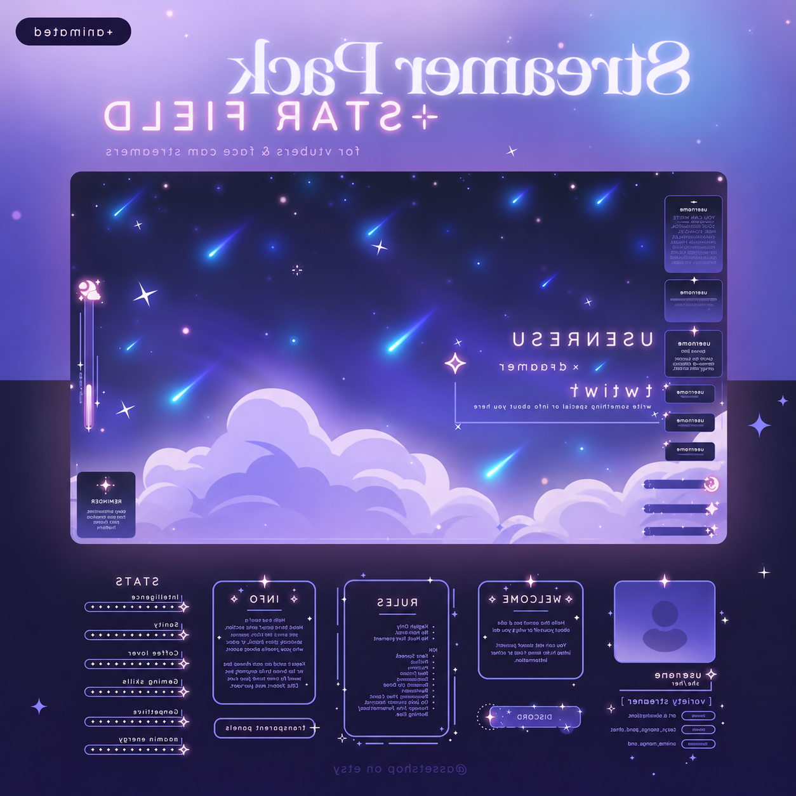
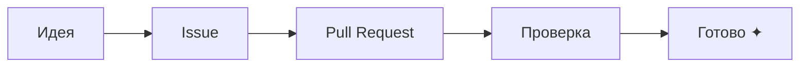

<div align="center">

# ✦ STARFIELD · GitHub Markdown

### Немного космоса для твоего репозитория

README · Issues · Pull Requests · Discussions

[](https://github.com/SkrudjReal/example-git-markdown/stargazers)
[](https://github.com/SkrudjReal/example-git-markdown/forks)
[](https://github.com/SkrudjReal/example-git-markdown/issues)



**Заготовка красивого README и коллекция GitHub-разметки.**

[Возможности](#-что-здесь-есть) · [Примеры](#-разметка-в-действии) · [Issues](https://github.com/SkrudjReal/example-git-markdown/issues) · [Pull Requests](https://github.com/SkrudjReal/example-git-markdown/pulls)

</div>

---

## ✧ Что здесь есть

| Элемент | Для чего |
| :--- | :--- |
| 💜 Бейджи | Быстрые ссылки на звёзды, форки и задачи |
| 🌌 Обложка | Визуальное настроение проекта |
| 💬 Предупреждения | Важные детали, которые легко заметить |
| ☑️ Чекбоксы | Небольшой план работы |
| 📂 Раскрывающиеся блоки | Логи и подробности |
| 🧩 Примеры | Разметка, которую можно скопировать |

> [!NOTE]
> Это демонстрационный репозиторий оформления. Здесь не нужно ничего устанавливать или запускать.

## ✦ Разметка в действии

### 01 · Акценты

**Важная мысль**, *небольшой акцент*, ~~старый вариант~~ и `имя_файла.md`.

```md
**Важная мысль**, *небольшой акцент*, ~~старый вариант~~ и `имя_файла.md`.
```

### 02 · Предупреждения

> [!TIP]
> Короткие инструкции оставляй на виду, а длинные логи убирай под раскрывающийся блок.

> [!IMPORTANT]
> Перед публикацией замени ссылки и подписи на данные своего проекта.

```md
> [!TIP]
> Полезная подсказка.

> [!IMPORTANT]
> Важная информация.
```

### 03 · План работы

- [x] Подобрать визуальный стиль
- [x] Добавить обложку и бейджи
- [x] Собрать примеры разметки
- [ ] Адаптировать шаблон под свой проект

```md
- [x] Готовая задача
- [ ] Следующая задача
```

### 04 · Подробности под катом

<details>
<summary>✧ Открыть пример отчёта об ошибке</summary>

#### Что произошло

Кратко опиши проблему и ожидаемый результат.

#### Как повторить

1. Открой нужную страницу.
2. Повтори действие.
3. Приложи текст ошибки и скриншот.

```text
Версия: 1.0.0
Окружение: Windows / Linux / macOS
Результат: описание наблюдаемого поведения
```

</details>

```html
<details>
<summary>Показать подробности</summary>

Здесь может быть текст, список или блок кода.

</details>
```

### 05 · Подсветка изменений

```diff
- Длинный неструктурированный текст
+ Заголовки, короткие абзацы и понятные примеры
```

### 06 · Схема работы



---

## ◇ Где использовать

| Место | Что оформить |
| :--- | :--- |
| `README.md` | Обложку, описание, установку и ссылки |
| Issues | Ошибки, предложения, шаги воспроизведения |
| Pull Requests | Изменения, проверки и чек-лист |
| Discussions | Вопросы, идеи и обсуждения |
| Wiki | Инструкции и справочные страницы |

Для заготовок задач используй `.github/ISSUE_TEMPLATE/*.md`, для форм с полями — `.github/ISSUE_TEMPLATE/*.yml`, для шаблона PR — `.github/pull_request_template.md`.

## ↗ Полезные ссылки

- [Оформление текста на GitHub](https://docs.github.com/en/get-started/writing-on-github/working-with-advanced-formatting)
- [Раскрывающиеся блоки](https://docs.github.com/en/get-started/writing-on-github/working-with-advanced-formatting/organizing-information-with-collapsed-sections)
- [Диаграммы Mermaid](https://docs.github.com/en/get-started/writing-on-github/working-with-advanced-formatting/creating-diagrams)
- [Формы для Issues](https://docs.github.com/en/communities/using-templates-to-encourage-useful-issues-and-pull-requests/syntax-for-issue-forms)
- [Референс оформления — CloakQuest3r](https://github.com/spyboy-productions/CloakQuest3r)

---

<div align="center">

### ✦ Make your README shine

Если шаблон пригодился — оставь ⭐

<sub>Оформление вдохновлено CloakQuest3r. Обложка предоставлена владельцем репозитория.</sub>

</div>
